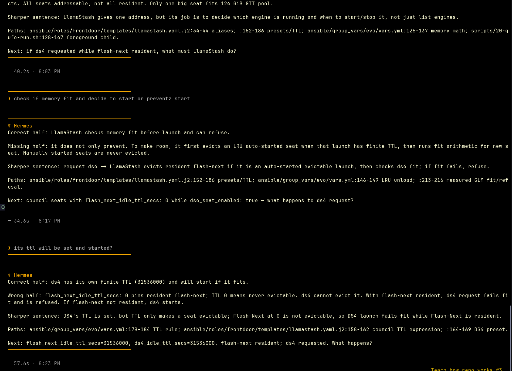

# feynman-teacher

Agent skill: teach a topic via Feynman loops until the learner can explain it themselves.

Pure-prompt skill (single `SKILL.md`, no dependencies). Works with Hermes Agent and other
agents that read SKILL.md-style skill files.

## Install

```bash
# Hermes
git clone https://github.com/dineshr93/feynman-teacher-skill ~/.hermes/skills/feynman-teacher
```

Or copy `SKILL.md` into any agent's skill/prompt directory.

## Use

Ask your agent to "teach me X Feynman-style" or "help me really understand X".

## Live in action

A real Hermes session using this skill: each answer is checked in halves — correct,
missing — then sharpened, with a next question. The learner refines the explanation
until it holds.



License: MIT
